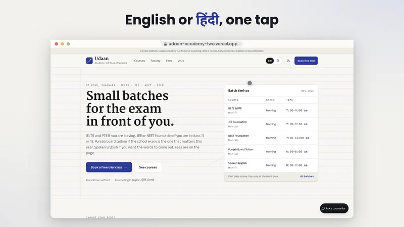

# Udaan Academy

Sample website for a fictional coaching centre on GT Road in Phagwara, Punjab. It is the third sample in a set sold to local businesses: a starter site, a business site with an AI counsellor, and a business site with booking.

Udaan Academy is not a real centre. The phone, address, and faculty names are placeholders. The site does not invent scores, ranks, or reviews.

The live sample is [udaan-academy-two.vercel.app](https://udaan-academy-two.vercel.app).

<p align="center"><a href="https://udaan-academy-two.vercel.app"></a></p>

The preview is silent and loops. It shows the English/Hindi switch, the courses, the fees, and the counsellor chat.

## Site

Public pages are `/` (home), `/courses` and `/courses/[slug]`, `/faculty`, `/fees`, and `/contact`. The header links to courses, faculty, fees, and the visit page. `/bookings` lists saved trial requests and stays closed until `BOOKINGS_VIEW_SECRET` is set.

Courses are IELTS & PTE, JEE Foundation, NEET Foundation, Punjab Board Tuition, and Spoken English. Fees are indicative ranges in the content file, shown on `/fees` and repeated by the counsellor: IELTS & PTE ₹8,000 to ₹12,000 for the package; JEE Foundation ₹4,200 to ₹5,500 a month; NEET Foundation ₹4,500 to ₹5,800 a month; Punjab Board ₹1,800 to ₹2,400 a month for classes 9 to 10 and ₹2,600 to ₹3,600 a month for classes 11 to 12; Spoken English ₹1,500 to ₹2,200 a month. Payment is at the centre. The site stores a trial request and does not take payment.

The header switches the site between English and Hindi. That choice is the `udaan-lang` cookie, kept for a year. The same header switches light and dark. Hindi page copy is in [`content/academy.hi.json`](content/academy.hi.json) and [`content/ui-copy.ts`](content/ui-copy.ts).

The counsellor sits on every page and answers in English, Hindi, or Punjabi. It follows the site language until the visitor picks one inside the chat. With no API key it answers from the course list. A free trial is a request: the form on `/contact`, or a finished chat, sends it to `POST /api/bookings`, and the visitor gets a reference number. The centre confirms the seat.

## Run locally

```bash
npm install
npm run dev
```

Production:

```bash
npm run build
npm start
```

No environment variables are required. The counsellor answers from the course list, and trial requests are stored in JSON.

## Swap in another business

Course data, prompts, and greetings live in [`content/academy.json`](content/academy.json): name, courses, fees, batches, faculty, facilities, FAQs, and the counsellor’s fixed lines in English, Hindi, and Punjabi. Hindi page copy is in [`content/academy.hi.json`](content/academy.hi.json) and [`content/ui-copy.ts`](content/ui-copy.ts). Punjabi faculty names, included items, and fee labels are in [`content/academy.pa.json`](content/academy.pa.json). Fee, time, and reference sentences are assembled in `lib/chat/respond.ts` from those course records. Course `match` phrases teach the counsellor which goal belongs to which course, in English, Hindi, and Punjabi. `pitch` is the sentence it says back.

## Optional environment

| Variable | Purpose |
| --- | --- |
| `NEXT_PUBLIC_SITE_URL` | Canonical URL for metadata. If unset, the site uses `https://$VERCEL_PROJECT_PRODUCTION_URL`. If neither is set, Open Graph URLs use the reserved host `https://example.invalid` so a build never points them at localhost. |
| `LLM_PROVIDER` | `openai`, `groq`, `openrouter`, `together`, `anthropic`, `gemini` (or `google`), or an OpenAI-compatible base URL. |
| `LLM_API_KEY` | Key for that provider. With no key, the rule-based counsellor is used. |
| `LLM_MODEL` | Model name for the provider. |
| `LLM_BASE_URL` | Optional base URL for an OpenAI-compatible provider. |
| `BOOKING_WEBHOOK_URL` | Optional URL that receives each saved trial request. A failed webhook does not undo the save. |
| `BOOKING_WEBHOOK_SECRET` | When set, the webhook request includes `x-udaan-signature`, an HMAC-SHA256 of the body. |
| `BOOKINGS_VIEW_SECRET` | Password for `/bookings`. The page stays closed until this is set. A correct password sets a signed cookie that expires after eight hours. |
| `BOOKINGS_STORE_PATH` | Override the JSON file used for requests. |
| `TRUST_PROXY` | Set to `1` only behind a proxy that overwrites `x-real-ip`. Off Vercel, forwarding headers are ignored unless this is set. |
| `TRUSTED_PROXY_HOPS` | How many right-hand `x-forwarded-for` hops to trust when `TRUST_PROXY=1`. `0`, the default, ignores that header and reads `x-real-ip`, which the proxy must overwrite. Above `0`, only `x-forwarded-for` is used and `x-real-ip` is ignored. |

The model is never allowed to confirm a booking. A request is recorded only by `POST /api/bookings`.

## Bookings

`POST /api/bookings` checks the name, a 10-digit mobile starting 6, 7, 8, or 9, the course, the batch, and a date in the next 45 days that is one of that batch’s days. A same-day trial is refused once that batch’s class has already ended (Asia/Kolkata). Email is optional. Caps:

- 3 booking attempts per known IP per 10 minutes, and 3 per phone number per 10 minutes
- 200 saved trials per hour for the whole site. A request that fails validation is not stored and does not count toward this ceiling. Repeated junk from a known address is limited in memory only, and that limit resets when the process restarts.
- one saved trial per phone number per day (Asia/Kolkata)
- 20 chat messages per known IP per 10 minutes, and 2000 chat messages per hour for the whole site (`/api/chat`), kept in memory
- 5 failed password guesses per known IP per 10 minutes, and 50 failed guesses per hour for the whole site on `/bookings`. The correct password is not counted, and it still opens the page after the ceiling is full.
- a 4 KB JSON body

IP trust assumes Vercel. On Vercel (`VERCEL=1`) the client address is `x-vercel-forwarded-for`, which the platform overwrites. Off Vercel, `x-real-ip` and `x-forwarded-for` are ignored unless `TRUST_PROXY=1`, because a visitor can set them. With neither set, per-IP caps are off and only per-phone and site-wide ceilings apply; put the site behind a proxy and set `TRUST_PROXY=1` for per-visitor limits. `TRUST_PROXY=1` requires a proxy that overwrites `x-real-ip`. When `TRUSTED_PROXY_HOPS` is greater than 0, that many right-hand `x-forwarded-for` hops are trusted and a client-supplied `x-real-ip` is ignored. Without a proxy in front, `next start` fills a missing `x-forwarded-for` with the socket address, so those direct visitors share one bucket whenever hops are above 0. In production, a startup warning is logged when the site is not on Vercel and `TRUST_PROXY` is unset.

Requests are written to `data/bookings.json`. If that path cannot be created, the file is `/tmp/udaan-academy-bookings.json`. On Vercel the filesystem is ephemeral, so that JSON file is temporary: it can disappear on a new deployment or a cold start, and it is not shared across instances. Use `BOOKING_WEBHOOK_URL` if a real centre needs the request somewhere durable. The README is the place that says this, because the site itself never promises an email.

## Checks

```bash
npm test
npm run lint
npm run typecheck
npm run build
```
